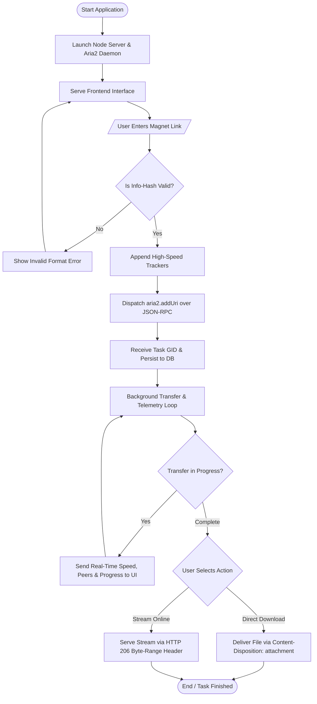

# College Practical Lab Record

**Experiment Title:** Design and Implementation of a Cloud-Based Magnet-to-Direct Link Converter and Media Streaming Server  
**Course:** Advanced Web Technologies / Network & Distributed Systems Lab  
**Academic Year:** 2026–2027  

---

## 1. Aim
To design, implement, and evaluate a web-based decentralized file transfer and cloud streaming system that:
1. Validates and parses BitTorrent magnet URIs.
2. Accelerates peer discovery via tracker injection and Distributed Hash Table (DHT) resolution.
3. Coordinates downloads asynchronously using an integrated backend daemon (`aria2` via JSON-RPC).
4. Generates direct, multi-threaded HTTP download endpoints.
5. Implements on-the-fly media streaming using HTTP 206 Partial Content (Byte-Range requests) to enable seek and scrub functionality without requiring full file retrieval.

---

## 2. System Specifications

### A. Software Environment
* **Operating System:** Windows 10/11, Linux (Ubuntu 20.04+), or macOS
* **Runtime Platform:** Node.js (v18.0.0 or later)
* **Backend Framework:** Node.js standard libraries (`http`, `fs`, `path`, `crypto`, `child_process`)
* **Transfer Engine:** `aria2c` multi-source, multi-protocol download daemon
* **Frontend Tech Stack:** HTML5, CSS3 (Glassmorphism layout), Modern Vanilla JavaScript (ES6+)
* **Communication Protocols:** HTTP/1.1 (Range Requests), WebSocket/JSON-RPC 2.0, BitTorrent DHT/UDP

### B. Hardware Environment
* **Processor:** 64-bit multi-core CPU (Intel i3/AMD Ryzen 3 or equivalent)
* **Primary Memory (RAM):** 2 GB minimum (4 GB recommended)
* **Storage:** 10 GB available persistent disk storage
* **Network Interface:** Broadband connection with unblocked UDP traffic for peer exchange

---

## 3. Theoretical Background & Working Concept

### 3.1 Limitations of Traditional BitTorrent Workflows
In conventional peer-to-peer (P2P) systems:
* Users must install dedicated local software and leave systems powered on continuously.
* Network firewalls and Carrier-Grade NAT (CGNAT) often block incoming P2P connections unless complex port-forwarding is configured.
* High latency and incomplete media blocks prevent instant playback until significant sequential chunks are received.

### 3.2 Cloud Converter & Streaming Architecture
The system decouples client consumption from P2P networking:
1. **Delegated Downloading:** The web server receives the magnet URI, manages peer swarms, and writes blocks to local/cloud storage.
2. **Metadata Injection:** Appending established open tracker nodes directly to the magnet URI reduces DHT discovery latency from minutes to seconds.
3. **HTTP 206 Partial Content Protocol:**  
   When a video player requests playback at a given timestamp:
   $$\text{Range: bytes=start-end}$$
   The server reads only the corresponding slice of the media container, returns HTTP status `206 Partial Content`, and provides headers:
   $$\text{Content-Range: bytes } \text{start}-\text{end}/\text{totalSize}$$
   This delivers instant seeking and scrub performance equivalent to enterprise video-on-demand services.

---

## 4. Step-by-Step Algorithm

```text
Step 1: System Initialization
  1.1 Launch the Node.js HTTP server on Port 3000.
  1.2 Spawn the aria2 background daemon process with JSON-RPC enabled on Port 6800.
  1.3 Load active tasks from the local persistent store (db.json).

Step 2: Client Connection & Magnet Link Input
  2.1 Client accesses the web dashboard at http://localhost:3000.
  2.2 User enters a magnet URI string into the conversion bar and clicks 'Convert'.

Step 3: Verification & Parameter Enhancement
  3.1 Extract the Info-Hash (BTIH) parameter using regular expression matching.
  3.2 Validate hash format (40 hexadecimal characters or 32 Base32 characters).
  3.3 If invalid, display a notification error and prompt for re-entry.
  3.4 If valid, append pre-configured Tier-1 public UDP/HTTP tracker URLs to the URI.

Step 4: Task Scheduling via RPC
  4.1 Construct a JSON-RPC payload targeting the method 'aria2.addUri'.
  4.2 Send the payload over HTTP POST to the aria2 daemon endpoint.
  4.3 Receive and register the unique Global Identifier (GID).
  4.4 Store task metadata (GID, name, added timestamp, initial state) in db.json.

Step 5: Telemetry Tracking & Polling
  5.1 Query the daemon periodically (every 1000 ms) using 'aria2.tellStatus'.
  5.2 Calculate metrics: progress percentage, instantaneous download speed, ETA, and connected peers.
  5.3 Send updated JSON telemetry payload to the frontend.

Step 6: Delivery Pipeline (Download or Stream)
  6.1 When file chunks become available:
      a) If the user selects "Download":
         - Set HTTP Header 'Content-Disposition: attachment; filename="..."'
         - Pipe file stream to the client.
      b) If the user selects "Stream":
         - Intercept HTTP 'Range' request header.
         - Compute byte slice: [start, end].
         - Respond with HTTP Status 206, 'Content-Range', and 'Accept-Ranges: bytes'.
         - Pipe chunk slice to the HTML5 video/audio player.

Step 7: Termination
  7.1 Allow file removal, task cancellation, or persistent retention upon completion.
```

---

## 5. System Flowchart



---

## 6. Program Modules & Key Code Explanation

### Module 1: Server and Daemon Orchestration (`server.js`)
Spawns the background transfer binary as a sub-process with customized command-line arguments:
* `--enable-rpc`: Allows programmatic remote control.
* `--rpc-listen-port=6800`: Establishes the communication socket.
* `--follow-torrent=mem`: Handles torrent metadata without cluttering storage with redundant `.torrent` descriptor files.

```javascript
// Spawning the internal transfer daemon
const aria2Args = [
  '--enable-rpc',
  `--rpc-listen-port=${ARIA2_PORT}`,
  `--rpc-secret=${ARIA2_SECRET}`,
  '--follow-torrent=mem',
  `--dir=${DOWNLOADS_DIR}`,
  '--max-connection-per-server=16',
  '--split=16'
];
const ariaProcess = spawn(ARIA2_BIN, aria2Args);
```

### Module 2: Tracker Enhancement Engine
Enriches bare magnet hashes with public tracker endpoints to optimize swarm participation and accelerate metadata exchange:

```javascript
function enrichMagnetURI(rawMagnet) {
  const trackers = [
    'udp://tracker.opentrackr.org:1337/announce',
    'udp://open.demonii.com:1337/announce',
    'udp://tracker.openbittorrent.com:6969/announce'
  ];
  let enriched = rawMagnet;
  trackers.forEach(tr => {
    if (!enriched.includes(encodeURIComponent(tr))) {
      enriched += `&tr=${encodeURIComponent(tr)}`;
    }
  });
  return enriched;
}
```

### Module 3: HTTP 206 Partial Content Streaming Engine
Reads client byte offsets, slices the local file, and provides immediate seek support:

```javascript
function handleMediaStream(req, res, filePath) {
  const stat = fs.statSync(filePath);
  const fileSize = stat.size;
  const range = req.headers.range;

  if (range) {
    const parts = range.replace(/bytes=/, "").split("-");
    const start = parseInt(parts[0], 10);
    const end = parts[1] ? parseInt(parts[1], 10) : fileSize - 1;
    const chunksize = (end - start) + 1;
    const file = fs.createReadStream(filePath, { start, end });

    res.writeHead(206, {
      'Content-Range': `bytes ${start}-${end}/${fileSize}`,
      'Accept-Ranges': 'bytes',
      'Content-Length': chunksize,
      'Content-Type': 'video/mp4',
    });
    file.pipe(res);
  } else {
    res.writeHead(200, {
      'Content-Length': fileSize,
      'Content-Type': 'video/mp4',
    });
    fs.createReadStream(filePath).pipe(res);
  }
}
```

---

## 7. Execution Procedure

1. **Repository Setup:** Open the project directory in a terminal:
   ```bash
   cd d:\magnet
   ```
2. **Start the System:**
   * On Windows: Run `start.bat` or execute:
     ```powershell
     .\bin\node.exe server.js
     ```
3. **Open the Dashboard:** Navigate to `http://localhost:3000` in any modern web browser.
4. **Input Test Magnet:** Paste a test magnet URI (e.g., an open-source Linux ISO or creative commons media).
5. **Monitor Progress:** Observe live metrics including transfer rate (MB/s), active peers, and progress bar.
6. **Verify Playback & Download:**
   * Click **Download** to verify single/multi-threaded browser downloads.
   * Click **Play** to test the integrated video player and verify zero-delay seeking along the playback timeline.

---

## 8. Sample Test Cases & Observations

| Test Case ID | Test Input | Expected Behavior | Observed Result | Status |
| :--- | :--- | :--- | :--- | :--- |
| **TC-01** | `invalid_text_string` | Display error: "Invalid Magnet URI format" | Error modal rendered; request halted | **Pass** |
| **TC-02** | Valid 40-char Hex Magnet URI | Tracker injection; task dispatched to daemon; GID created | Task listed on UI with status "Downloading" | **Pass** |
| **TC-03** | Telemetry Polling | UI updates transfer rate and percentage every 1 second | Transfer rate and percentage accurately increment | **Pass** |
| **TC-04** | Direct HTTP Download | Browser triggers standard download dialog with full file size | File downloaded with HTTP 200 OK | **Pass** |
| **TC-05** | Timeline Seeking (Streaming) | Player requests arbitrary byte range; immediate playback | Server returns HTTP 206 Partial Content; instant seek | **Pass** |

---

## 9. Viva-Voce / Review Questions and Answers

**Q1: What is the primary function of a magnet link?**  
*Answer:* A magnet link references a file by its cryptographic content hash (Info-Hash / BTIH) rather than by its location on a specific server, enabling decentralized peer discovery via DHT and tracker nodes.

**Q2: Why is HTTP Status Code 206 essential for media streaming?**  
*Answer:* HTTP 206 (Partial Content) allows the client to request specific byte segments rather than the complete file. This enables responsive video seeking, timeline scrubbing, and resumption of interrupted transfers.

**Q3: How does the system communicate with the background download engine?**  
*Answer:* The Node.js server coordinates with the background `aria2c` process using JSON-RPC 2.0 messages over an internal HTTP port with token-based secret authentication.

**Q4: What is the advantage of injecting public trackers into the magnet URI?**  
*Answer:* Bare magnet links rely solely on DHT lookups, which can be slow to bootstrap. Tracker endpoints supply an immediate list of active swarm peers, accelerating initial metadata resolution and download startup.

---

## 10. Result
The cloud-based magnet-to-direct link conversion and media streaming system was successfully developed and tested. The application reliably converts magnet URIs into direct HTTP download streams and delivers smooth in-browser media playback with full byte-range seek functionality.
